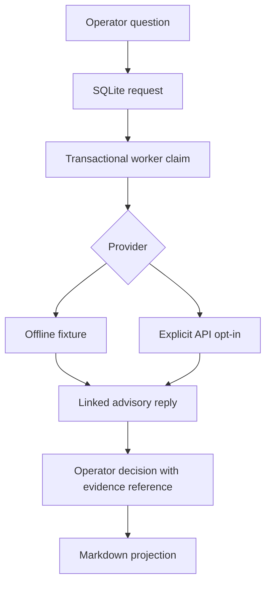

# Architecture and boundaries

`Store.post` validates input; `Store.claim` uses `BEGIN IMMEDIATE` to reserve one
request; `process_one` calls an adapter and atomically persists the reply plus
DONE state. `Store.decide` records an operator's assessment. `Store.export`
quotes external content as advisory text. It is a readable projection, not an
execution format or safe HTML renderer. Treat model-generated links as untrusted.

SQLite `WAL` plus `synchronous=FULL` is configured; physical durability still
depends on filesystem, disk and OS behavior. No physical power-loss claim is
made. SQLite should be on a local filesystem, not a shared network drive.

The database is not encrypted or tamper-evident. The CLI assumes a trusted
single operating-system user and a private data directory. It has no user
authentication and is not a multi-tenant service.
